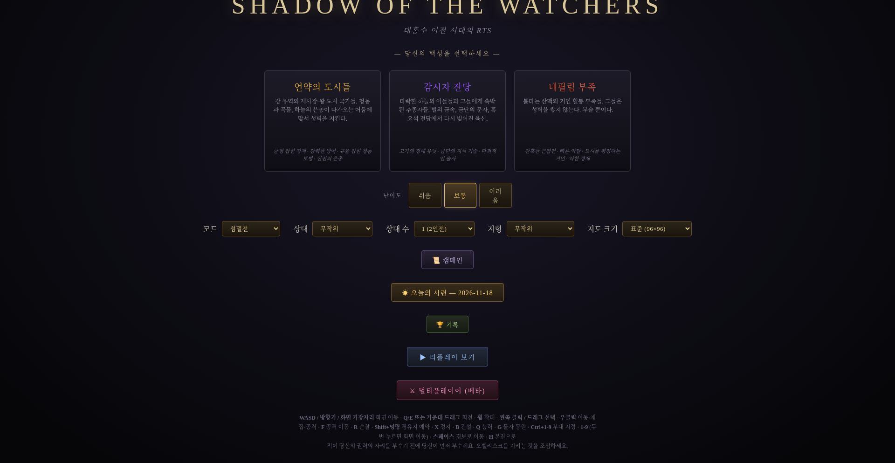
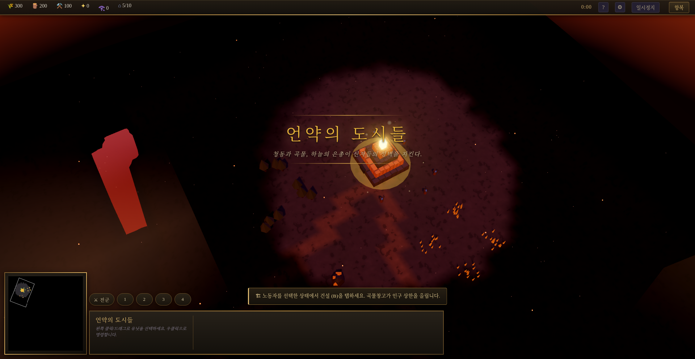

# Shadow of the Watchers — 한국어판

> 대홍수 이전 시대를 배경으로 하는 브라우저 실시간 전략(RTS) 게임. 세 개의 비대칭 진영 중 하나를 지휘해 자원을 모으고, 군대를 키우고, 적의 본거지를 무너뜨리세요.


**[▶ 브라우저에서 바로 플레이](https://sigco3111.github.io/ugh-guys-ko/)**

원작: **[atxgreene/Ugh-Guys-](https://github.com/atxgreene/Ugh-Guys-)** (CC0-1.0, 퍼블릭 도메인). 이 저장소는 원작을 한국어로 번역한 한글화 포크입니다.




---

## 한글화 내용

- 메인 메뉴, 진영 소개, 난이도/모드 선택, 캠페인, 설정, 도움말, 인게임 HUD와 튜토리얼 안내까지 한국어로 번역했습니다.
- 설정에서 **언어 / Language**를 전환할 수 있습니다(한국어 / English).
- 한글 폰트(Apple SD Gothic Neo, Malgun Gothic, Noto Sans KR)를 폰트 스택에 추가해 한글이 깨지지 않게 했습니다.
- 번역은 i18n 사전 모듈(`src/i18n*.js`)로 분리되어 있어 원문과 나란히 관리합니다.

## 게임 소개

Shadow of the Watchers는 **Three.js**와 **Vite**로 처음부터 만든 스타크래프트풍 RTS입니다. 별도의 게임 엔진, 외부 아트, 오디오 파일, 저작권 자산 없이 모든 모델·사운드·맵을 코드로 절차 생성합니다.

### 세 진영

| 진영 | 정체성 | 플레이 스타일 |
| --- | --- | --- |
| **언약의 도시들** | 제사장-왕 도시 국가 | 균형 잡힌 경제, 방어, 카운터 |
| **감시자 잔당** | 타락한 감시자의 추종자 | 정예 유닛과 금단의 기술 |
| **네필림 부족** | 거인 혈통 약탈자 | 잔혹한 근접전과 기지 파괴 |

### 주요 특징

- 진영별 고유 유닛·건물·밸런스의 비대칭 3진영 디자인
- 자원 채취, 생산 대기열, 기술 업그레이드, 보급의 완전한 경제·생산
- A* 경로 탐색, 시야 스무딩, 물리 기반 유닛 분리
- 지속 발견형 전장의 안개와 미니맵 연동
- 절차 생성 지형과 결정적 노이즈
- 경제·정찰·방어·공격을 수행하는 반응형 AI 상대
- WebAudio API로 실시간 합성하는 사운드(오디오 파일 0개)

### 조작

| 입력 | 동작 |
| --- | --- |
| **왼쪽 클릭** | 유닛·건물 선택 |
| **왼쪽 클릭 + 드래그** | 박스 선택(일꾼보다 병사 우선) |
| **오른쪽 클릭** | 이동 / 채취 / 공격 / 집결지 설정 / 건설 재개 |
| **WASD**, **방향키**, **화면 가장자리** | 카메라 이동 |
| **Q / E** 또는 **가운데 드래그** | 카메라 회전 |
| **마우스 휠** | 줌 |
| **F** | 공격 이동 |
| **X** | 정지 |
| **B** | 건설 메뉴(일꾼) · **Esc** 취소 |
| **H** | 본진으로 화면 이동 |
| **Ctrl + 숫자** | 부대 지정 · **숫자**로 호출 |

## 로컬 실행

```bash
git clone https://github.com/sigco3111/ugh-guys-ko.git
cd ugh-guys-ko
npm install
npm run dev      # Vite가 로컬 URL을 출력합니다
```

프로덕션 빌드:

```bash
npm run build    # dist/에 정적 파일 출력
npm run preview  # 빌드 결과를 로컬에서 서빙
```

## 배포

`main`에 푸시하면 [GitHub Actions 워크플로](.github/workflows/pages.yml)가 Vite 빌드 후 GitHub Pages에 배포합니다: **https://sigco3111.github.io/ugh-guys-ko/**

## 검증 상태와 외부 의존성

- **검증 완료**: 싱글플레이 부팅, 유닛 생성, 시뮬레이션 진행, 한국어 UI 표시를 실제 배포 페이지에서 확인했습니다(위 스크린샷).
- **미검증**: 멀티플레이(베타)는 외부 릴레이 서버가 필요한 기능으로, 이번 한글화 검증 범위에서는 실제 외부 서버 접속을 시도하지 않았습니다. 원작의 기본 동작(버튼 표시 조건 등)은 그대로 유지했습니다.

## 라이선스

원작과 동일하게 [CC0-1.0](LICENSE) — 퍼블릭 도메인입니다. 원작자 크레딧: atxgreene.
